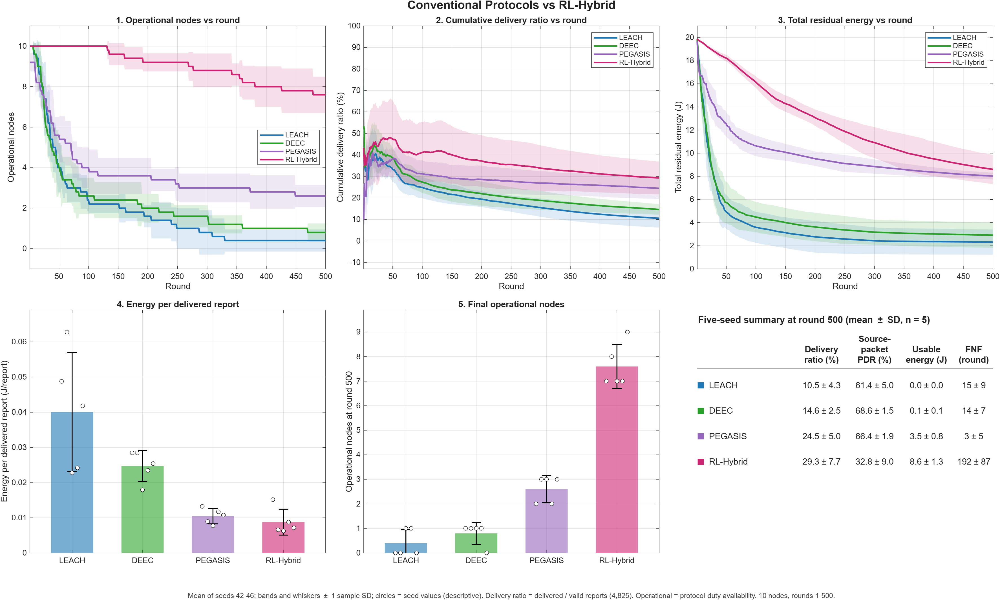
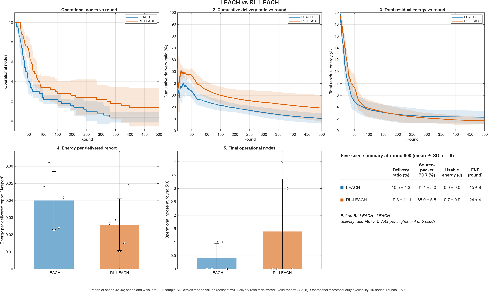
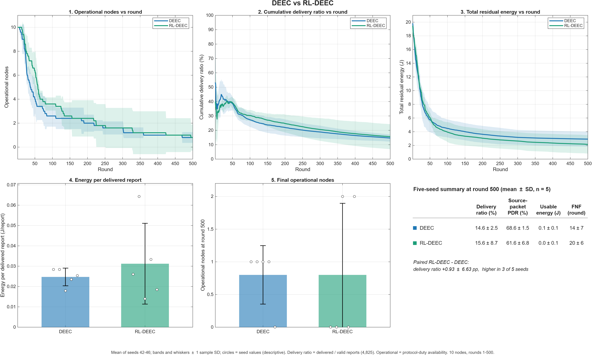
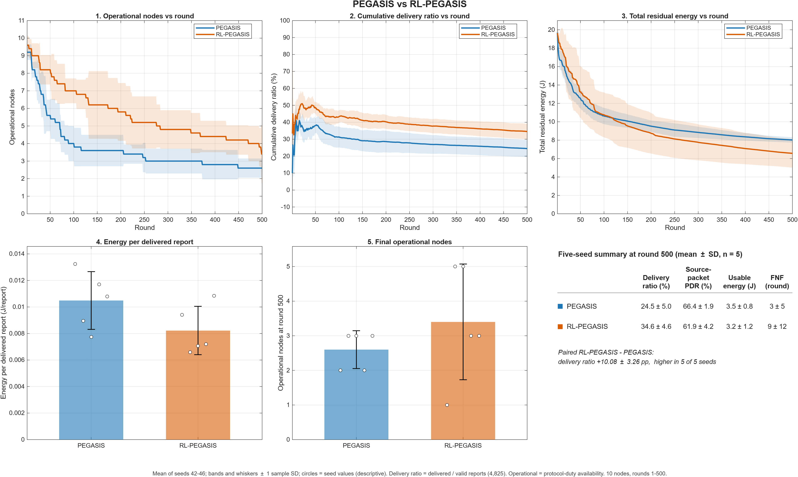
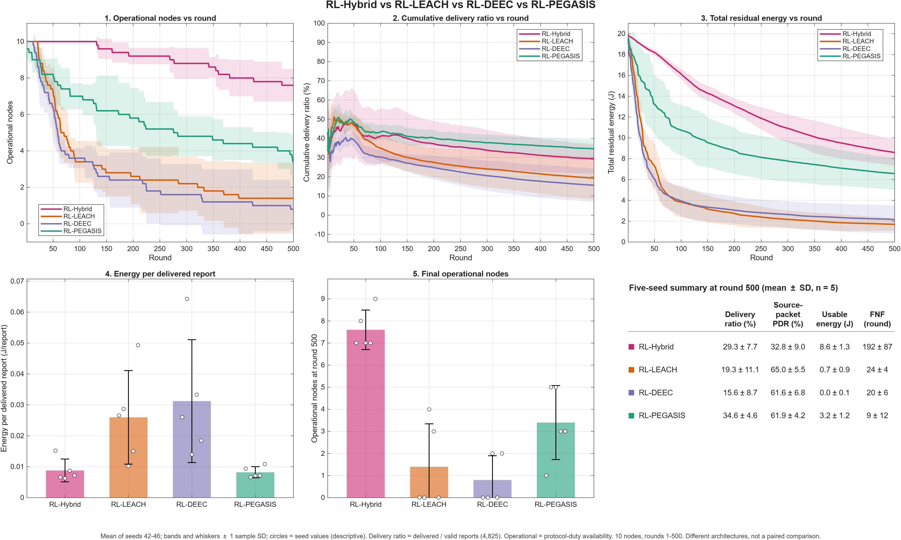
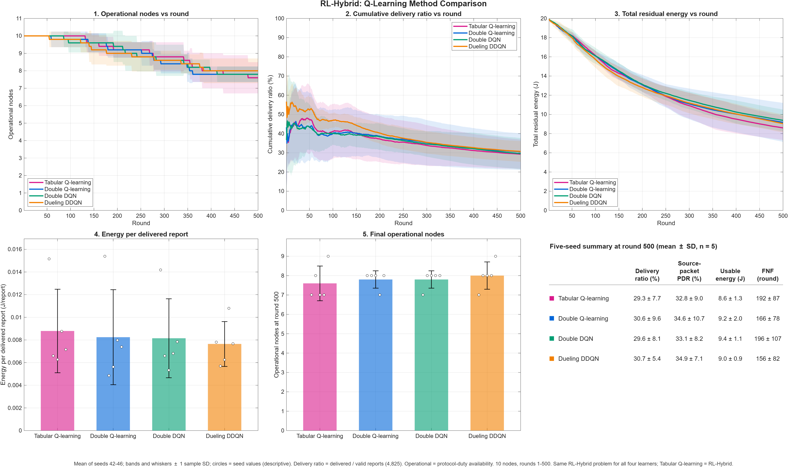

# Periyar WSN Adaptive Routing

MATLAB implementation of reinforcement-learning-based adaptive routing protocols for energy-efficient
environmental monitoring in wireless sensor networks (WSNs).

The project (B.Tech, Electronics and Communication Engineering) simulates a 10-node WSN that carries the
water-quality reports of ten Kerala State Pollution Control Board (KSPCB) monitoring stations on the
Periyar river to one base station. It compares three conventional clustering/chain protocols, their
reinforcement-learning (RL) extensions, and the proposed **RL-Hybrid** router, and compares four learning
methods inside RL-Hybrid.

* [Methods](#methods) · [RL-Hybrid](#rl-hybrid-the-proposed-router) · [Why Tabular Q-learning](#why-tabular-q-learning)
* [Experimental setup](#experimental-setup) · [Development stages](#development-stages) · [Results](#results) · [Figures](#figures)
* [Reproduce the results](#reproduce-the-results) · [Dataset setup](#dataset-setup) · [Limitations](#limitations)

## Methods

| Group | Method | How routes and roles are chosen |
|---|---|---|
| Conventional | **LEACH** | Random rotating cluster heads (CHs); members join the nearest CH; each CH aggregates and sends directly to the base station (BS). |
| | **DEEC** | LEACH-style clustering with the CH probability weighted by a node's residual energy relative to the network average. |
| | **PEGASIS** | A greedy chain of all nodes; reports are passed along the chain to one leader, which sends to the BS; the leader rotates every round. |
| RL extensions | **RL-LEACH** | LEACH's election proposes CH candidates; a learned gate (Q-table over BS distance, relative energy and nodes still upstream) decides whether each candidate serves, and picks the best-valued node if none does. |
| | **RL-DEEC** | DEEC's energy-weighted probability multiplied by a learned communication-cost correction (state value of serving, weight beta = 16), normalised so the expected number of CHs stays DEEC's. |
| | **RL-PEGASIS** | The PEGASIS chain is unchanged; the leader is chosen by a learned value (BS distance, relative energy, chain-branch length) instead of fixed rotation, with an energy guard (only nodes with at least 0.5 x mean energy may lead). |
| Proposed | **RL-Hybrid** | Online tabular Q-learning for both cluster assignment and multi-hop relay routing (below). |
| Learner comparison | **Tabular Q-learning, Double Q-learning, Double DQN, Dueling DDQN** | The same RL-Hybrid problem (environment, actions, reward, constraints) with a different learning method; Tabular Q-learning is RL-Hybrid's own learner. |

## RL-Hybrid (the proposed router)

RL-Hybrid combines clustering with learned multi-hop routing:

1. **Cluster assignment.** Each station with a report chooses a cluster head among the reachable operational
   nodes (or itself), using its Q-values.
2. **Relay routing.** Each cluster head forwards its aggregated reports hop by hop; every hop is chosen by the
   acting node's Q-table among candidates that make progress toward the BS (at most 15 hops).

**State** (3^8 = 6,561 states per node): eight features binned into three levels: own residual energy,
candidate's residual energy, estimated link quality, link distance relative to d0, progress toward the BS,
the node's own observed reliability of that link, candidate load and remaining hop budget.
**Actions:** the next node or the BS. **Learning:** one independent Q-table per node, updated online with
Q-learning (alpha = 0.10, gamma = 0.90) and epsilon-greedy exploration (epsilon from 0.25, decaying by 0.9985
per round to 0.05).

**Reward:** +2.0 for delivery at the BS and -1.0 for a lost or stranded report; a successful relay earns
+0.15 x link-quality estimate + 0.15 x progress + 0.10 x relay residual energy + 0.10 x (1 - forwarding
burden), minus 0.10 x normalised energy spent and 0.05 per hop.

**Causal information rule:** before acting, a node may use only geometry, the distance-based link prior,
its own past link outcomes, and current energies and loads. The realised channel of the current round is
never read; a transmission's success is looked up only after its energy has been spent. Each seed learns
from scratch.

## Why Tabular Q-learning

The four learners were run on the identical RL-Hybrid problem and seeds (graph G6). Their results overlap
within seed-to-seed variation:

| Learner | Delivery ratio (%) | Operational nodes at round 500 | Energy per delivered report (mJ) | Run time per seed (s) |
|---|---|---|---|---|
| Tabular Q-learning | 29.3 ± 7.7 | 7.6 ± 0.9 | 8.8 ± 3.7 | 1.5 |
| Double Q-learning | 30.6 ± 9.6 | 7.8 ± 0.4 | 8.2 ± 4.2 | 1.5 |
| Double DQN | 29.6 ± 8.1 | 7.8 ± 0.4 | 8.2 ± 3.5 | 14.9 |
| Dueling DDQN | 30.7 ± 5.4 | 8.0 ± 0.7 | 7.6 ± 2.0 | 15.8 |

Tabular Q-learning is used because no alternative gives a gain larger than the variation between seeds, while
it needs about one tenth of the computation of the DQN learners, no neural network or replay memory, and
its learned values can be inspected directly. That suits small, battery-powered sensor nodes.

## Experimental setup

* 10 sensing nodes that also forward (no relay-only nodes); one BS at (600 m, 25 m); 600 m x 50 m river section.
  Node positions are a simulation assumption (the station positions of the project's earlier 50-node layout,
  per seed), not surveyed coordinates.
* 2 J per node; 4000-bit packets; first-order radio model: E_elec = 50 nJ/bit, E_fs = 10 pJ/bit/m^2,
  E_mp = 0.0013 pJ/bit/m^4 (d0 = 87.7 m), E_DA = 5 nJ/bit per report.
* Links succeed with a distance-based probability (1 - d/480 between nodes, 1 - d/720 to the BS, with
  bounded noise); the channel realisation is identical for every method within a seed.
* Workload: the KSPCB Periyar analysis report (January-July 2025); 212 sampling dates are mapped onto a
  1000-round schedule, and the evaluation uses rounds 1-500, which contain 4,825 valid station reports.
* Seeds 42-46; all results are means with ±1 sample standard deviation (n = 5).
* Energy accounting: a frame that carries m station reports is charged as m packets for every method, because
  the delivery metric counts each report. A node becomes unavailable when it cannot pay for an operation its
  protocol role requires.

**Metrics.** Delivery ratio = delivered reports / valid reports scheduled (cumulative; 4,825 by round 500).
Source-packet PDR = delivered / source packets actually generated. Usable energy = battery energy of
operational nodes. FNF = first node to become operationally unavailable. Energy per delivered report =
energy spent / reports delivered.

## Development stages

1. **Earlier 50-node study** (separate project): 10 stations plus 40 relay-only nodes over 1000 rounds.
2. **10-node network (this repository):** the 10 stations only, each sensing and forwarding.
3. **Workload correction:** a fixed 1000-round reporting schedule and a fixed 1000-round energy-planning horizon,
   so that stopping at round 500 does not compress the workload or change RL budgets.
4. **RL extension redesign:** the first extension designs mostly reordered the parent's own choices and barely
   differed from their parents. The final RL-LEACH, RL-DEEC and RL-PEGASIS designs were developed on seeds 47-50 and evaluated on seeds 42-46 with a
   selection rule fixed in advance.
5. **Energy-accounting audit:** per-node energy tracing showed that clustering and chain frames were charged as
   one packet however many reports they carried. All methods were rerun with per-report charging; the results
   below come from that run.

## Results

Round 500, mean ± sample SD over seeds 42-46 (`results/results_500rounds.mat`).

| Method | Delivery ratio (%) | Source-packet PDR (%) | Operational nodes | Energy per delivered report (mJ) | FNF (round) | Mean delay (ms) |
|---|---|---|---|---|---|---|
| LEACH | 10.5 ± 4.3 | 61.4 ± 5.0 | 0.4 ± 0.5 | 40.1 ± 16.9 | 15 | 31.3 |
| DEEC | 14.6 ± 2.5 | 68.6 ± 1.5 | 0.8 ± 0.4 | 24.7 ± 4.3 | 14 | 29.9 |
| PEGASIS | 24.5 ± 5.0 | 66.4 ± 1.9 | 2.6 ± 0.5 | 10.5 ± 2.2 | 3 | 41.5 |
| RL-LEACH | 19.3 ± 11.1 | 65.0 ± 5.5 | 1.4 ± 1.9 | 26.0 ± 15.1 | 24 | 33.9 |
| RL-DEEC | 15.6 ± 8.7 | 61.6 ± 6.8 | 0.8 ± 1.1 | 31.2 ± 19.9 | 20 | 34.2 |
| RL-PEGASIS | 34.6 ± 4.6 | 61.9 ± 4.2 | 3.4 ± 1.7 | 8.2 ± 1.8 | 9 | 51.9 |
| **RL-Hybrid** (Tabular Q-learning) | 29.3 ± 7.7 | 32.8 ± 9.0 | **7.6 ± 0.9** | 8.8 ± 3.7 | **192** | 48.4 |

Paired differences (RL extension - parent, same seeds): RL-LEACH +8.75 ± 7.42 pp delivery ratio (higher in
4 of 5 seeds); RL-DEEC +0.93 ± 6.63 pp (3 of 5, within seed variation); RL-PEGASIS +10.08 ± 3.26 pp
(5 of 5).

**Interpretation.** RL-Hybrid keeps by far the most nodes operational (7.6 of 10 at round 500; first node
failure near round 192) with one of the lowest energies per delivered report, i.e. the longest network
lifetime. RL-PEGASIS delivers the largest share of reports by round 500 (34.6%), but its network shrinks.
RL-Hybrid's source-packet PDR is lower than the clustering protocols' because its multi-hop routes cross more
lossy links per report; its advantage is lifetime and sustained delivery, not per-packet reliability.

## Figures

Six dashboard figures: three line panels (operational nodes, cumulative
delivery ratio, total residual energy; mean with ±1 SD band), two bar panels (energy per delivered report and
operational nodes at round 500; mean, SD whisker and the five seed values) and a five-seed summary table.

| | |
|---|---|
|  **G1** Conventional protocols vs RL-Hybrid |  **G2** LEACH vs RL-LEACH |
|  **G3** DEEC vs RL-DEEC |  **G4** PEGASIS vs RL-PEGASIS |
|  **G5** RL-Hybrid vs RL-LEACH, RL-DEEC and RL-PEGASIS |  **G6** Q-learning method comparison |

Editable MATLAB figure files (`.fig`) are next to each PNG.

## Reproduce the results

Requirements: MATLAB (developed and validated with R2026a; no toolboxes) and the dataset ([Dataset setup](#dataset-setup)).

```matlab
cd Periyar-WSN-Adaptive-Routing
run_experiment('results/my_run.mat')    % 11 methods x 5 seeds (about 5 minutes); default output results/results_500rounds.mat
plot_figures(fullfile(pwd, 'figures', 'my_run'))   % the six figures from results/results_500rounds.mat; default output figures/
```

Both functions refuse to overwrite existing outputs, so a rerun is written to a new file or folder as above.

| Path | Contents |
|---|---|
| `wsn_config.m` | All experiment settings (nodes, rounds, seeds, topology, dataset path) |
| `run_experiment.m` | Runs the experiment |
| `plot_figures.m` | Draws the six figures |
| `protocols/` | LEACH, DEEC, PEGASIS, RL-LEACH, RL-DEEC, RL-PEGASIS, RL-Hybrid and the learner comparison |
| `simulation/` | Dataset loader, workload builder, scenario/channel generator, radio energy model, metric extraction |
| `results/` | `results_500rounds.mat` (final results); `reference_layout.mat` (node positions and workload, used to check that a rerun uses the same topology and workload) |
| `figures/` | The six figures (PNG and FIG) |
| `data/` | Place `consdata.xlsx` here (not included) |

## Dataset setup

The KSPCB workbook (*Analysis Report of River Periyar, January-July 2025*, Environmental Surveillance Centre,
Eloor) is **not included**, because no licence permitting its redistribution has been established. Obtain it as
described in [`data/README.md`](data/README.md), save it as `data/consdata.xlsx` and check its MD5
(`6100b72899bd76df5a393fbbc5fb898a`). The saved results and figures can be inspected without it.

## Limitations

* The energy model covers radio communication only; idle listening, sensing, MAC/control traffic and
  retransmissions are not modelled, so absolute lifetimes are optimistic.
* Node positions are assumed; five seeds per method.

## File checksums (MD5)

```
407012aa28e86b4cca42d383a00919eb  results/results_500rounds.mat
f7a7ab9290ac395274df75a1d15f86e2  results/reference_layout.mat
ae56ca6ddc9341805995dea972bc0418  figures/G1_Conventional_vs_RL_Hybrid.png
e457e8f296910c0d7e39e7f8793aa1ad  figures/G2_LEACH_vs_RL_LEACH.png
0bbe5f6a9862b7a244bb79815dda57d2  figures/G3_DEEC_vs_RL_DEEC.png
8735f2f12a2b6be9a7a06550460e1ba4  figures/G4_PEGASIS_vs_RL_PEGASIS.png
4878ff6ca9ec0a4f47d4e0c78ce3a695  figures/G5_RL_Hybrid_vs_RL_Extensions.png
43976f36b04361f5c09be6940e85ef5b  figures/G6_Q_Learning_Methods.png
```
